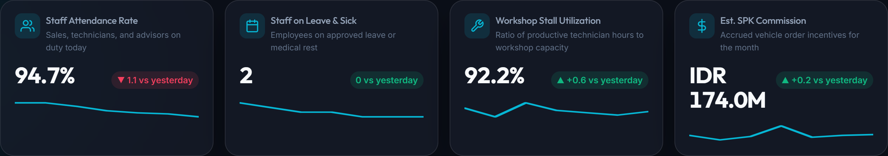
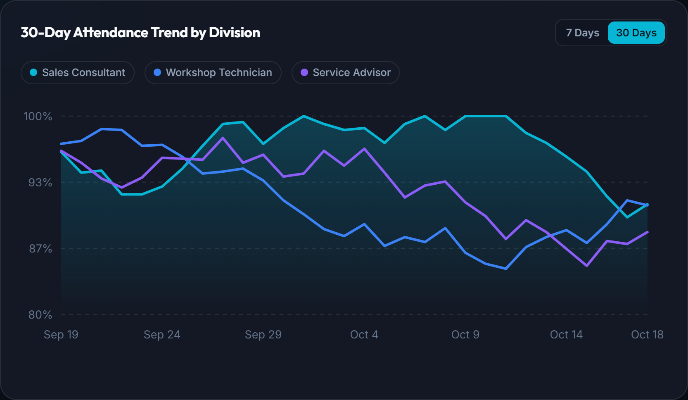
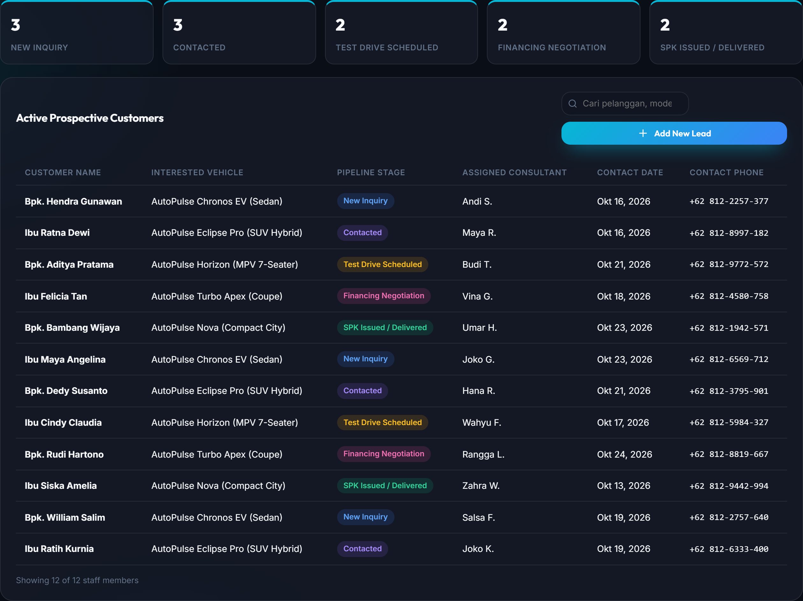
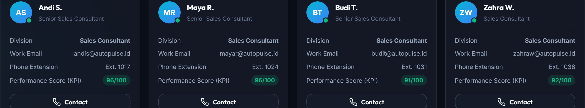
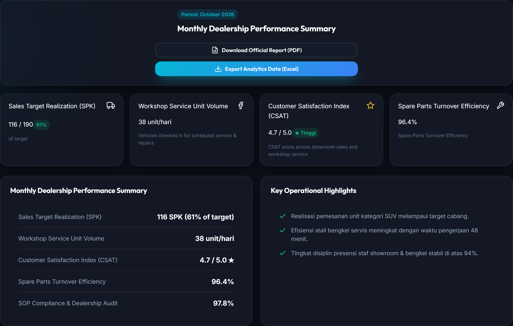

# AutoPulse CRM — Automotive Dealership & Workforce Management System

[](https://developer.mozilla.org/en-US/docs/Web/JavaScript)
[](https://developer.mozilla.org/en-US/docs/Web/CSS)
[](https://developer.mozilla.org/en-US/docs/Web/HTML)
[-success)](https://nodejs.org/api/test.html)
[](https://autopulse-crm.vercel.app/)
[](#technology-stack)
[](LICENSE)

AutoPulse CRM is an automotive 3S (Sales, Service, Spare Parts) dealership and workforce management system. Built entirely on vanilla web standards with zero third-party dependencies, it provides real-time operational telemetry, staff attendance tracking, vehicle sales pipelines, commission calculations, and branch performance analytics.

---

## Live Access

- Production URL: [https://autopulse-crm.vercel.app/](https://autopulse-crm.vercel.app/)
- GitHub Pages Mirror: [https://iqbal-alpha.github.io/autopulse-crm/](https://iqbal-alpha.github.io/autopulse-crm/)
- Access Mode: Direct dashboard entry without authentication gates.
- Multi-Branch & Persona Switcher: Switch between HRD & People Operations and Branch Manager across five dealership branches (Jakarta Pusat, BSD City, Bandung, Surabaya, Medan). Preferences persist via localStorage.

---

## Core Capabilities

### 1. Operational Telemetry & KPI Engine
Dynamic performance indicators featuring custom SVG sparklines and day-over-day trend analysis.



- HRD Metrics: Staff attendance rate, approved leaves, workshop stall utilization, and SPK commissions.
- Branch Manager Metrics: Delivered units, service intake volume, lead conversion rate, and CSAT index.

### 2. Native Data Visualization
Mathematical SVG rendering engine generating responsive charts without external charting libraries.



- Custom SVG line charts with gradient fills, interactive crosshair tooltips, and 7-day/30-day filters.
- Semicircle target gauges and donut charts for quota achievement and workforce distribution.

### 3. Prospective Customer Pipeline
End-to-end sales funnel tracking prospective vehicle buyers from initial inquiry to final unit delivery.



- Five conversion stages: New Inquiry, Contacted, Test Drive Scheduled, Financing Negotiation, and SPK Issued / Delivered.
- Vehicle interest classification (Sedan EV, Hybrid SUV, MPV, City Car) with assigned sales consultant tracking.

### 4. 3S Workforce Directory
Consolidated personnel directory across Sales, Workshop, and Service Advisory divisions.



- Real-time attendance indicators, internal extensions, work emails, and individual KPI ratings.
- Role-based division filtering and direct contact triggers.

### 5. Branch Executive Analytics
Comprehensive monthly operational reporting with audit compliance and multi-format data exports.



- Summary of SPK sales targets, service stall turnaround, spare parts turnover, and dealer SOP compliance audits.
- One-click PDF report generation and structured Excel analytics exports.

---

## Technology Stack

| Layer | Implementation | Details |
| :--- | :--- | :--- |
| Markup | Semantic HTML5 | Accessible landmarks, skip-links, ARIA live regions |
| Styling | Modern CSS3 | Custom Properties, Glassmorphism, CSS Grid, Flexbox |
| Runtime Logic | Vanilla JavaScript (ES6+) | Modular architecture, reactive state, zero npm dependencies |
| Visualizations | Native SVG | Algorithmic path generation for lines, bars, donuts, and gauges |
| Storage | Web Storage API | Client-side persistence for branch, role, language, and theme |
| Verification | Node.js Test Runner | 18 automated unit and DOM integrity tests (100% pass rate) |

---

## System Architecture

```text
autopulse-crm/
├── index.html              # Main application shell with multi-role subviews
├── styles.css              # Design tokens, typography, and dark/light themes
├── dashboard.css          # Layout grids, components, and module styling
├── dashboard.js            # State management, SVG charting, and tab routing
├── dashboard-data.js       # Deterministic seeded mock data engine
├── dashboard-i18n.js       # Bilingual dictionary (Indonesian and English)
├── serve.js                # Built-in HTTP static preview server
├── assets/                 # Vector favicons, images, and interface previews
├── tests/                  # Automated test suite (DOM integrity, data, i18n)
└── README.md               # Technical documentation
```

---

## Local Setup

### Option 1: Native Node.js Server

```bash
git clone https://github.com/iqbal-alpha/autopulse-crm.git
cd autopulse-crm
node serve.js
```

Access the application at `http://127.0.0.1:5500`.

### Option 2: Direct File Execution
Open `index.html` directly in any modern web browser or serve via any static web server.

---

## Automated Verification

Run the test suite using Node.js built-in test runner:

```bash
node tests/integrity.test.js
node tests/dashboard-data.test.js
node tests/i18n.test.js
```

All 18 unit tests validate:
- HTML ID uniqueness and JavaScript DOM query alignment.
- 1:1 key parity across Indonesian and English dictionaries.
- Deterministic pseudorandom data generation across all branches.
- Semantic script load order and accessibility attributes.

---

## License

This project is licensed under the [MIT License](LICENSE).
